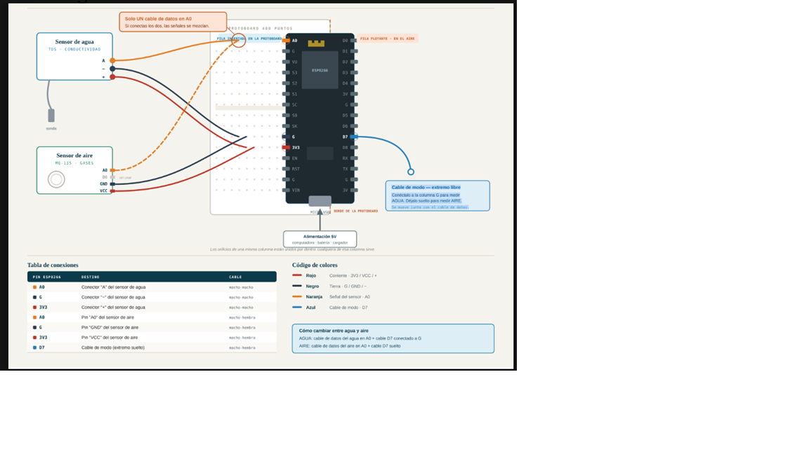
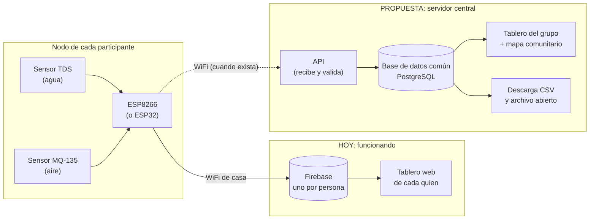

# Hydor-Cualli 💧🌬️

Proyecto comunitario de **monitoreo ambiental**. Cada participante arma un **nodo**
barato que mide la **calidad del agua** (sensor TDS) y la **calidad del aire**
(sensor MQ-135) y manda sus datos por WiFi para verlos en un tablero.

Este repo es la **caja de herramientas del grupo**: el firmware que se carga a cada
nodo, las guías para armarlo y la propuesta de base de datos común.

## 🔌 Diagramas de cableado

| Diseño | Diagrama | Estado |
|---|---|---|
| **Original, 1 sensor** (A0 + jumper D7) — diseño de **Emily Acosta** | [`docs/armado/original-1sensor/`](docs/armado/original-1sensor/) (imagen abajo) | ✅ Probado en hardware · ⚠️ histórico: no sirve para más de un sensor a la vez |
| **2 sensores a la vez** (ESP8266 + ADS1115) ⭐ recomendado | [`docs/armado/DIAGRAMA_ESP8266_2SENSORES.html`](docs/armado/DIAGRAMA_ESP8266_2SENSORES.html) + [guía](docs/armado/GUIA_ARMADO_2SENSORES.md) | 🧪 Falta probarlo en hardware |

Ver el diagrama original (1 sensor)

Índice completo y cómo abrir los `.html`: [`docs/armado/LEEME.md`](docs/armado/LEEME.md).

---

## ¿Qué está armado y en qué estado?

| Pieza | Estado | Dónde está |
|---|---|---|
| Nodo de **1 sensor** (diseño original, jumper en D7) | ✅ Probado en hardware real con Firebase | [`firmware/esp8266-oficial-base`](firmware/esp8266-oficial-base/) |
| Mismo nodo + **historial** (ya no se pierden las lecturas) | ✅ Probado en hardware real con Firebase | [`firmware/esp8266-oficial-historial`](firmware/esp8266-oficial-historial/) |
| Nodo de **2 sensores a la vez** (ESP8266 + ADS1115) | 🧪 Escrito y revisado, **falta probarlo en hardware** | [`firmware/esp8266-ads1115-2sensores`](firmware/esp8266-ads1115-2sensores/) |
| Guía y diagramas para armar el nodo de 2 sensores | ✅ Listos | [`docs/armado/`](docs/armado/) |
| Tablero web (Firebase, uno por persona) | ✅ En uso por el colectivo | Cada quien con su proyecto de Firebase |
| **Servidor central** (una base de datos para todos) | 📝 Propuesta; el esquema y la API se probaron solo en una computadora de pruebas | [`docs/BASE-DE-DATOS.md`](docs/BASE-DE-DATOS.md) |
| Nodo **ESP32** | ⏳ Pendiente | — |
| Calibración de sensores | ⏳ Pendiente (el MQ-135 da un índice, no ppm todavía) | Ver LEEME de cada firmware |

---

## Cómo funciona (hoy y lo que se propone)

- **Hoy:** cada nodo publica a **su propio Firebase**. El firmware con historial guarda
  todas las lecturas, no solo la última.
- **Propuesta:** un servidor central donde se junten los datos de todos, guardados para
  siempre, con mapa comunitario. El firmware de 2 sensores ya trae el interruptor
  `USAR_API` para mandar a los dos lados cuando exista. Detalle en
  [`docs/BASE-DE-DATOS.md`](docs/BASE-DE-DATOS.md).

---

## ¿Cuál firmware uso?

| Si tienes… | Usa |
|---|---|
| ESP8266 y **un** sensor (o quieres lo ya probado) | [`esp8266-oficial-historial`](firmware/esp8266-oficial-historial/) |
| ESP8266 + **ADS1115** + los **dos** sensores | [`esp8266-ads1115-2sensores`](firmware/esp8266-ads1115-2sensores/) (en prueba) |
| Quieres el original tal cual, sin cambios | [`esp8266-oficial-base`](firmware/esp8266-oficial-base/) |

Cada carpeta trae su **LEEME.md** con el cableado y el paso a paso.

---

## Cómo armar y cargar un nodo

1. **Arma el hardware.** Nodo de 1 sensor: el LEEME de su carpeta. Nodo de 2 sensores:
   empieza por [`docs/armado/`](docs/armado/) (guía + diagramas; ahí se explica cómo
   abrir los diagramas `.html`).
2. Instala **VSCode** y su extensión **PlatformIO IDE** (una sola vez).
3. **Descarga este proyecto** (botón verde `Code → Download ZIP`, o `git clone`).
4. Abre en VSCode la carpeta del firmware que elegiste.
5. Pon **tu WiFi y tu Firebase**:
   - firmwares `oficial-*`: en el bloque **"CONFIGURA ESTO"** de `src/main.cpp`;
   - firmware de 2 sensores: copia `src/secretos.ejemplo.h` como `src/secretos.h` y llénalo.
6. Conecta el ESP por **USB** (cable de datos, no de solo carga) → **Upload** (→) →
   **Monitor Serial** a 115200.

> **Firebase:** crea un proyecto gratis en [firebase.google.com](https://firebase.google.com),
> activa la **Realtime Database** y copia su **host** y un **token**.

> 🔒 **Nunca subas tus contraseñas a GitHub.** Si vas a compartir tu código, deja los
> valores de ejemplo. `secretos.h` ya está en `.gitignore` para que no se suba por error.

---

## ¿Algo no jala?

Abre un **Issue** aquí en GitHub (es como dejar un recado, no necesitas saber de
código): qué placa tienes, qué firmware usaste y qué te aparece en el Monitor Serial.

---

## Créditos

- **Proyecto y código original:** **Emily Acosta** — idea, firmware y desarrollo del
  sistema Hydor-Cualli.
- **Mejora del historial, nodo de 2 sensores, guías y propuesta de servidor:**
  Adrian Del Río — ADRA-Tech ([@gmork69](https://github.com/gmork69)).

Gracias a toda la comunidad que sostiene el proyecto. 💧🌬️
