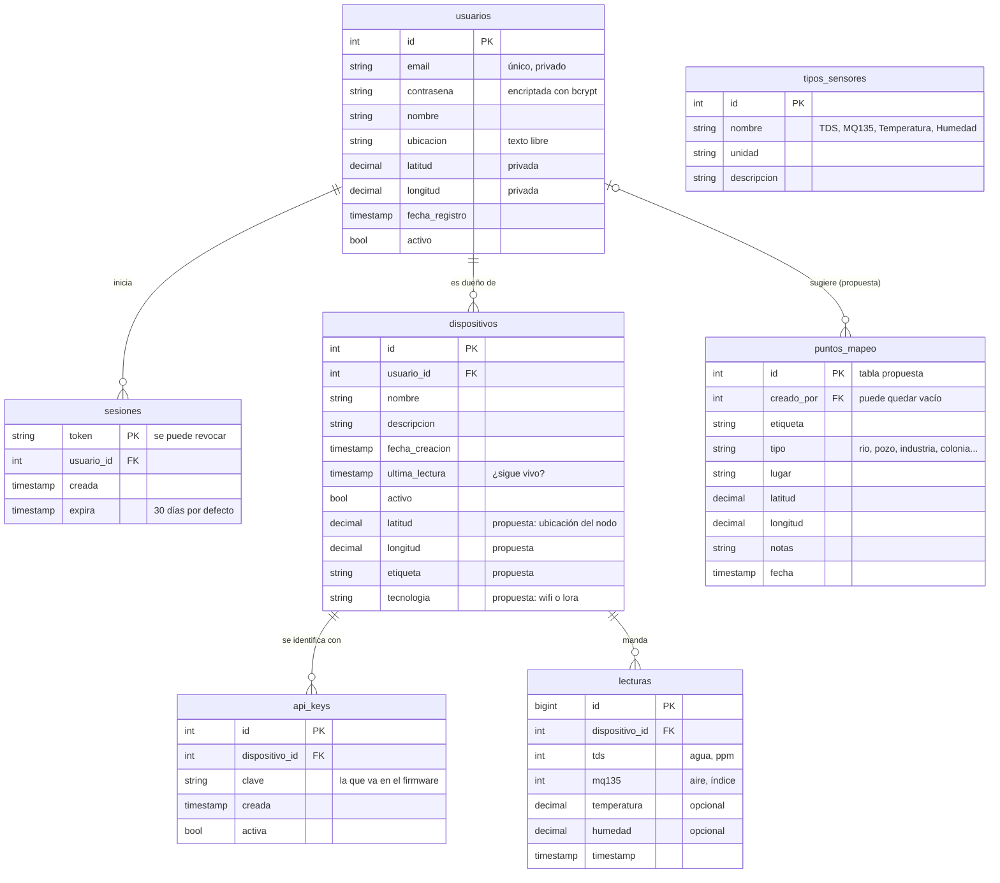
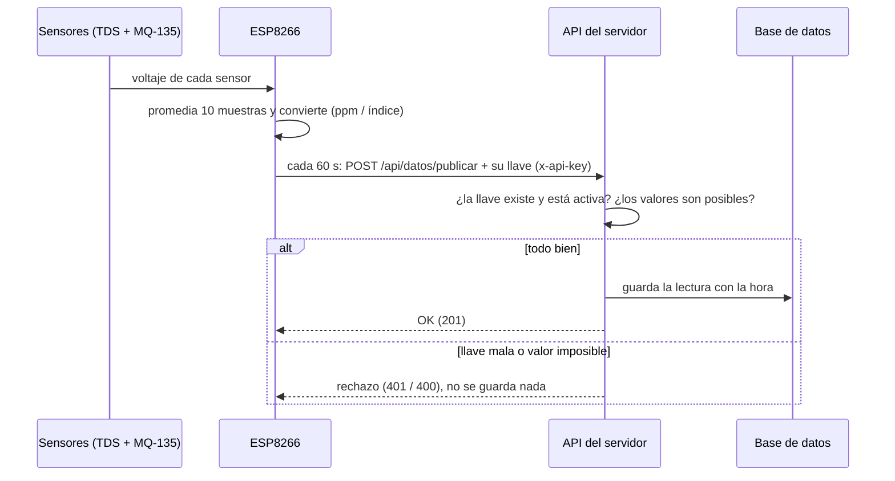

# Propuesta de base de datos común · Hydor-Cualli

> Documento para el grupo. Explica **cómo guardaríamos los datos de todos los nodos en un
> solo lugar**, qué se guarda de cada voluntario y qué decisiones nos tocan.
>
> **Leyenda:** ✅ probado · 📝 propuesta (escrito, no probado) · ❓ decisión del grupo

---

## 1. ¿Por qué una base de datos común?

Hoy cada participante manda sus lecturas a **su propio Firebase**. Funciona, pero:

- los datos quedan repartidos en decenas de cuentas distintas;
- no se puede ver el panorama de todos juntos (un mapa, comparar zonas);
- si alguien borra o pierde su proyecto, se pierden sus datos.

La propuesta es un **servidor central**: un solo lugar donde llegan las lecturas de todos
los nodos y se guardan **para siempre**.

---

## 2. Qué está probado y qué no

| Pieza | Estado |
|---|---|
| Esquema de 6 tablas (`init.sql`) en PostgreSQL 15 | ✅ Crea todo sin errores |
| API que recibe lecturas, valida y deja ver/descargar solo lo tuyo | ✅ 16/16 pruebas automáticas, **en una computadora de pruebas** |
| Seguridad básica: contraseñas encriptadas, sesiones que vencen, nadie ve datos de otro | ✅ Incluido en esas pruebas |
| Un nodo real publicando a esta base | ⏳ No se ha hecho todavía |
| Extensión de ubicación por nodo + mapa comunitario (`migracion_sjr.sql`) | 📝 Escrita, **no aplicada ni probada** |
| Servidor en internet, HTTPS, respaldos automáticos | 📝 No existe aún |
| Vista pública / mapa del grupo | 📝 No existe aún |
| Aviso de privacidad y consentimiento | ❓ **No existe. Hay que escribirlo antes de registrar a nadie** |

---

## 3. Las tablas (diagrama)

Las 6 tablas base más la extensión de ubicación/mapa (marcada como *propuesta*).

### Para qué sirve cada tabla

| Tabla | En palabras sencillas |
|---|---|
| `usuarios` | Cada voluntario: su correo, su contraseña (guardada encriptada, nadie la puede leer), su nombre y, si quiere, dónde vive. |
| `sesiones` | El "estoy dentro" cuando entras al tablero. Vence sola y se puede cerrar. |
| `dispositivos` | Cada nodo que arma un voluntario. Una persona puede tener varios (hasta 10). Guarda cuándo mandó su último dato, para saber si sigue prendido. |
| `api_keys` | La "llave" de cada nodo. Va escrita en su firmware y es lo que le permite mandar datos. Si se pierde o se filtra, se apaga y se hace otra. |
| `lecturas` | **Lo importante:** cada medición (agua, aire y, si hay, temperatura y humedad) con su fecha y hora. Con 60 nodos mandando cada minuto son ~86 mil filas al día; está preparada para crecer a millones. |
| `tipos_sensores` | Un catálogo de qué mide cada sensor y en qué unidad. Sirve para agregar sensores nuevos después. |
| `puntos_mapeo` *(propuesta)* | El **mapa comunitario**: lugares que el grupo quiere marcar (un río, un pozo, una industria, una colonia con olores). |

La **extensión de ubicación** *(propuesta)* le da a cada **nodo** su propia ubicación,
separada de la del dueño: alguien puede vivir en un lugar y tener su nodo junto a un río
en otro. También dice si el nodo habla por **WiFi** o, más adelante, por **LoRa** (radio de
largo alcance, sin depender del WiFi de una casa).

---

## 4. Cómo llega un dato del sensor a la base

1. El nodo lee sus sensores y calcula el valor.
2. Lo manda por internet al servidor junto con **su llave**.
3. El servidor revisa que la llave sea válida y que los números tengan sentido (por
   ejemplo, rechaza un TDS negativo). Si algo está mal, **no guarda nada**.
4. Si todo está bien, la lectura queda guardada con su hora, ligada a ese nodo.
5. El voluntario entra al tablero con su correo y contraseña y ve **solo sus nodos**;
   puede descargar sus datos en CSV.

---

## 5. Qué se guarda de cada voluntario y cómo se protege

**Lo que se guarda:** correo, nombre, contraseña (encriptada), una ubicación opcional y
sus nodos con sus lecturas.

**Cómo se protege hoy (✅ probado):**
- La contraseña se guarda **encriptada** (bcrypt): ni quien administra el servidor la ve.
- Cada quien solo puede ver y descargar **lo suyo**; se probó que un intruso no puede ver
  el nodo de otro.
- Las sesiones vencen solas; hay límites de intentos para frenar abusos.
- La base no queda abierta a internet: solo la API habla con ella.

**Lo que se propone (📝) para cuando haya datos públicos:**

| Dato | Público | Privado |
|---|:---:|:---:|
| Lecturas de agua y aire | ✅ | |
| Ubicación **aproximada** del nodo (colonia / redondeada a ~1 km) | ✅ | |
| Ubicación **exacta** del nodo o de la casa | | 🔒 |
| Correo, nombre, contraseña | | 🔒 |
| Llave del nodo | | 🔒 |

- **Aviso de privacidad y consentimiento: pendiente (❓).** Antes de registrar a cualquier
  voluntario hay que tener por escrito qué se guarda, para qué, quién lo ve, qué se publica
  y cómo pedir que se borren sus datos.
- Conocido y aceptable para un piloto: las llaves de los nodos se guardan tal cual para que
  el dueño las pueda recuperar desde el tablero. Si se roba la base, se tendrían que
  cambiar todas las llaves.

---

## 6. ¿Dónde puede vivir el servidor?

| Opción | A favor | En contra |
|---|---|---|
| **Servidor propio del proyecto** (un VPS pequeño contratado para Hydor-Cualli) | Separado de todo lo demás; siempre en línea; el grupo decide | Cuesta una renta mensual; alguien lo tiene que mantener |
| **Homelab** (una computadora en casa de algún voluntario) | Casi gratis; bueno para el piloto | Depende de la luz e internet de esa casa; hay que abrirlo a internet con cuidado |
| **Servicio gestionado** (PostgreSQL en la nube, p. ej. Supabase, Neon o similar) | No hay que mantener el servidor; respaldos incluidos | Planes gratis con límites; los datos viven en la cuenta de un tercero |

> Lo que **no** se propone: montarlo en servidores que ya tienen datos de otros clientes o
> proyectos. Un proyecto comunitario con datos de voluntarios debe vivir **aparte**.

Sea cual sea, necesita: **HTTPS**, **respaldos automáticos** y una persona responsable.

---

## 7. Decisiones que tiene que tomar el grupo

1. ❓ **¿Seguimos con Firebase por persona mientras tanto**, o pasamos directo al servidor
   central? (El firmware de 2 sensores puede mandar a los dos a la vez.)
2. ❓ **¿Dónde vive el servidor?** (sección 6) y **quién lo administra**.
3. ❓ **¿De quién son los datos y con qué licencia se publican?** (p. ej. datos abiertos
   con atribución).
4. ❓ **Aviso de privacidad:** qué es público y qué no (la tabla de la sección 5 es una
   propuesta).
5. ❓ **¿Usamos PostgreSQL** (lo que ya está hecho y probado) **u otra plataforma** de
   series de tiempo? La recomendación es quedarse con PostgreSQL: usuarios, llaves y
   permisos ya existen; las gráficas tipo Grafana se le pueden conectar después.
6. ❓ **Archivo de largo plazo:** ¿publicamos copias periódicas en un repositorio abierto
   con DOI (como Zenodo) para que los datos sean citables?

---

## 8. Siguientes pasos sugeridos

1. Probar con **un nodo real** mandando a la base en una computadora de pruebas.
2. Aplicar y probar la extensión de ubicación/mapa.
3. Escribir el aviso de privacidad.
4. Elegir dónde vive el servidor y montarlo con HTTPS y respaldos.
5. Piloto con 5-10 voluntarios antes de abrirlo a todo el grupo.
