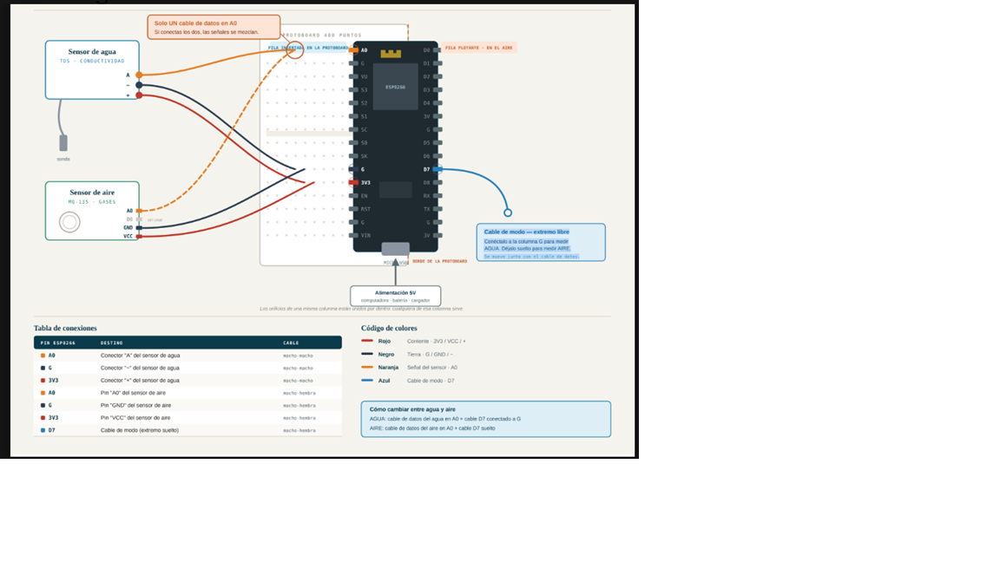

# Diagrama original — nodo de 1 sensor (A0 + jumper D7)

**Diseño original del proyecto Hydor-Cualli: Emily Acosta.**
Es el cableado del firmware que nos dio la organización
([`esp8266-oficial-base`](../../../firmware/esp8266-oficial-base/) y su versión con historial
[`esp8266-oficial-historial`](../../../firmware/esp8266-oficial-historial/)).

## Cómo funciona

- El ESP8266 tiene **una sola entrada analógica (A0)**, así que se mide **un sensor a la vez**.
- Los dos sensores se alimentan a **3V3** y **GND**; solo **un cable de datos** va a A0.
- El **cable de modo en D7** le dice al firmware qué está midiendo:
  - **D7 a G (GND)** → modo **AGUA** (TDS en A0).
  - **D7 suelto** → modo **AIRE** (MQ-135 en A0).
- Para cambiar de sensor se mueven **juntos** el cable de datos y el cable de D7.

## Estado

- ✅ **Probado en hardware real** con Firebase (firmware con historial).
- ⚠️ **Histórico / no recomendado para crecer:** este montaje **no sirve para medir los dos
  sensores a la vez ni para agregar más**, porque todo depende del único pin A0. Si conectas
  dos cables de datos a A0, las señales se mezclan. Para 2 sensores a la vez usa el
  [nodo con ADS1115](../GUIA_ARMADO_2SENSORES.md).
